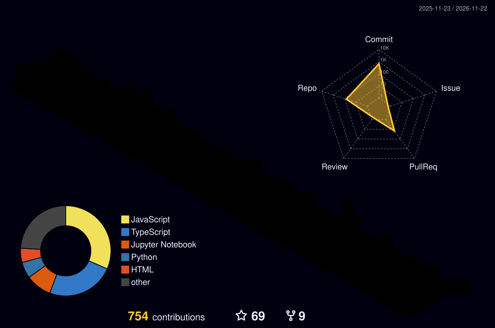

<!-- Terminal card: generated daily by .github/workflows/profile.yml (scripts/profile-card.mjs) -->
<a href="https://github.com/ABHINAVJINDAL26">
  <picture>
    <source media="(prefers-color-scheme: dark)" srcset="./dark_mode.svg">
    
  </picture>
</a>

  
  
  
  

### `> ls ./stack`

  

  
  
  
  
  
  
  
  

### `> ls ./projects`

<!-- TODO: check each link matches your exact repo name -->
| Project | What it does | Built with |
|---|---|---|
| 🗳️ **[Smart Voting System](https://github.com/ABHINAVJINDAL26/Smart-Voting-System)** | Secure online voting with authentication and tamper-resistant vote storage | Node.js · Firebase · MongoDB · MySQL |
| 🛒 **[Amazon Clone](https://github.com/ABHINAVJINDAL26/Amazon-Clone)** | E-commerce storefront with product listing and cart flow | React · Node.js · MongoDB |
| 🎧 **[Spotify Clone](https://github.com/ABHINAVJINDAL26/Spotify-Clone)** | Music player UI with playlists and playback controls | HTML · CSS · JavaScript |
| 🏆 **IIT Ropar Hackathon** | AI-based innovation — **2nd place** | Python · ML |

### `> git log --graph`

  

  

### `> tail -f activity.log`

<!-- Auto-updated hourly by .github/workflows/activity.yml — don't edit between the markers -->
<!--START_SECTION:activity-->
<!--END_SECTION:activity-->

  <picture>
    <source media="(prefers-color-scheme: dark)" srcset="https://raw.githubusercontent.com/ABHINAVJINDAL26/ABHINAVJINDAL26/output/github-contribution-grid-snake-dark.svg"/>
    
  </picture>

<code>// code with purpose · build with clarity · innovate with consistency</code>

